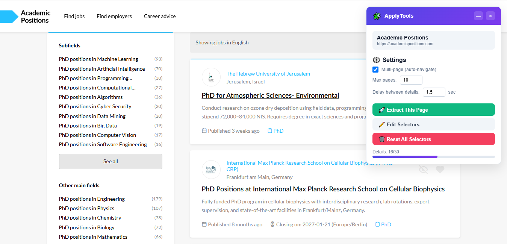
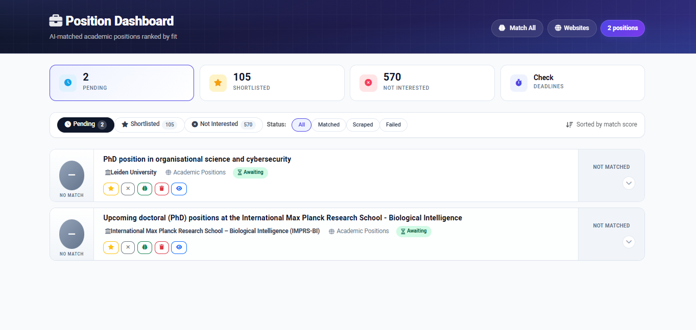
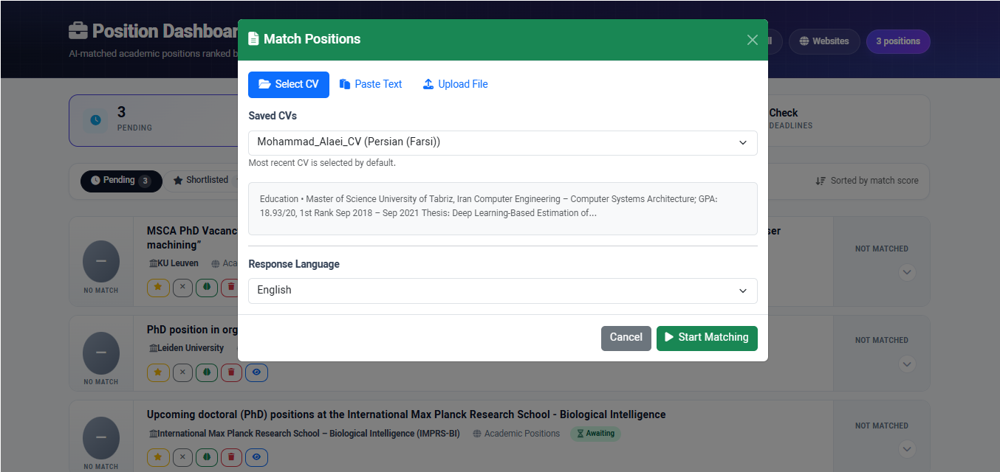
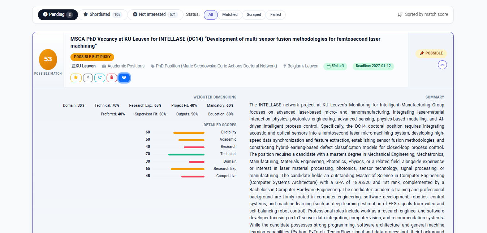

# 🔬 ApplyTools – Smart Academic Position Matcher

**ApplyTools** is a Django-based application that captures academic and research positions from any website via a Chrome extension, matches them against your CV using AI, and helps you manage your job applications. It uses a **multi-provider AI fallback chain** — Google Gemini (free tier) as the primary provider, with DeepSeek's free web chat (via the [Deepseek-API](https://github.com/sums001/Deepseek-API) library) as a reliable fallback when Gemini is overloaded or rate-limited.

---

## 🚀 Features

### Position Capture (via Chrome Extension)
- **Capture positions from any website with a click** — A Chrome extension lets you point at a position card on any website (Academic Positions, FindAPhD, DAAD, a university job board, even a professor's lab page) and add it to your dashboard. No selectors, no scraping code — just point and click.
- **5-step visual picker wizard** — Walks you through picking the listing card, title, link, company, and detail container on any site. Once configured for one site, the extension can extract hundreds of positions from that site automatically.
- **Auto-detection for modern sites** — For sites that publish structured `JobPosting` data (schema.org JSON-LD), the extension detects it automatically — no picking required.
- **Multi-page extraction** — Configure once, then let the extension walk through pagination to collect every page of results.
- **Works on protected sites** — Because the extension runs in your actual browser with your actual session, it works on sites protected by Cloudflare, Datadome, or that require login — exactly as you would browse manually.

### AI-Powered Matching with Fallback Chain
- **Multi-provider AI fallback chain** — Tries Google Gemini (free tier, 1M token context) first. If Gemini is overloaded (503) or rate-limited (429), it automatically falls back to the next model in your chain, ending with DeepSeek's free web chat as a reliable last resort. You configure the order in `.env`.
- **Structured scoring, not just a number** — Every match returns an overall score, 7 sub-scores (eligibility, academic fit, research fit, technical fit, domain fit, research experience, competitiveness), evidence breakdown, and a final verdict (Strongly Recommended / Recommended / Possible but Risky / Not Recommended).
- **Conversation rotation** — To prevent context overflow and keep match quality high on long batches, the AI conversation is automatically reset every N positions (default 10, configurable).
- **Multi-language matching** — AI responses available in English, Persian (Farsi), German, French, Spanish, Arabic, and Chinese.
- **Re-match anytime** — If a match looks wrong (score 0, error in summary), one click deletes the bad match and re-runs it.

### CV Management
- **Save CVs** — Paste text, upload a PDF, or upload a TXT file. Extracted text is stored for reuse.
- **Select existing CV** — Default selection is your most recent CV; pick any saved CV from the dropdown.
- **Multi-language matching** — Responses available in English, Persian (Farsi), German, French, Spanish, Arabic, and Chinese.

### Application Workflow
- **Track every position** from first discovery to final outcome: Pending Review → Shortlisted → Applied → Interviewing → Offered → Accepted/Rejected.
- **One-click status changes** — Move a position between stages directly from the dashboard. Decisions are saved instantly and used to improve future match recommendations.
- **Deadline tracking** — Positions with passed deadlines are flagged automatically so you can focus on what's still actionable.

### Real-Time Progress (No Lost Work)
- **Server-Sent Events (SSE)** — Match progress streams live to your browser.
- **Survives page refresh** — Reconnect-after-refresh means your in-flight match picks up where it left off, even if you accidentally close the tab.
- **Stop buttons** — Cancel any operation cleanly at the next safe checkpoint.

### UI / UX
- **Unified design system** — Indigo-navy gradient header, slate backgrounds, Inter + Vazir + JetBrains Mono fonts.
- **Bento-grid stats strip** — Clickable cards (Total / Active / Inactive / Positions Scraped) that filter the list.
- **Sticky filter bar** — Stays visible while scrolling; client-side search on the websites page.
- **Score rings with glow** — Semantic colors (emerald/indigo/amber/rose) for match quality at a glance.
- **Toast notifications** — Non-blocking feedback for every action (replaces `alert()`).
- **RTL detail panel** — AI output in Persian/Arabic renders right-to-left correctly.
- **Custom scrollbar + focus-visible accessibility + fade-up entrance animations.**

### Platform
- **REST API** — All operations available via a clean REST API with pagination. Power users can script their own workflows.
- **Admin-friendly** — Web UI to add/edit websites and manage positions; full Django admin for power users.
- **Initial data fixtures** — Pre-configured websites and AI prompts for a quick start.

---

## 📸 Screenshots


*Extension view on the Academic Positions website, displaying the selected filters used to search for relevant positions.*


*Main dashboard displaying the academic positions retrieved through the web scraping process.*


*AI-Matcher view, featuring options to select a CV and preferred language to assess eligibility for a specific position or all available positions.*


*Detailed view of a matched position, displaying AI-generated eligibility scores and personalized recommendations.*

---

## 🙏 Acknowledgments

This project would not be possible without the excellent work of **sums001** and contributors on:

**[Deepseek-API](https://github.com/sums001/Deepseek-API)** — A free LLM API powered by DeepSeek that turns the free chat at chat.deepseek.com into an OpenAI-compatible API. No API key, no credits, no paid plan. We use it as the fallback provider in our AI chain.

We also thank **Google AI Studio** for providing free access to the Gemini API with a generous free tier (500 requests/day, 1M token context).

We are deeply grateful for these open-source contributions that make AI-powered matching accessible to everyone.

---

## 📋 Requirements

- **Python 3.10+** (3.13 recommended) — for the Django backend
- **Google Chrome** (or any Chromium browser) — for the extension
- **A Google AI Studio API key** (free — get one at https://aistudio.google.com/apikey)
- **A DeepSeek account** (free — used as fallback provider via the Deepseek-API library)
- **Git** — to clone the repository
- **`pdfplumber`** — for PDF CV extraction (installed via `requirements.txt`)

You do **not** need to install Playwright or any browser automation tools — the Chrome extension handles all position capture.

---

## 🛠️ Installation

Follow these steps to set up ApplyTools on your local machine.

### 1. Clone the repository

```bash
git clone https://github.com/alaeimo/applytools.git
cd applytools
```

### 2. Create a virtual environment

**macOS / Linux:**
```bash
python3 -m venv venv
source venv/bin/activate
```

**Windows (PowerShell):**
```bash
python -m venv venv
venv\Scripts\Activate.ps1
```

**Windows (cmd):**
```bash
python -m venv venv
venv\Scripts\activate.bat
```

### 3. Copy environment configuration

The project includes a template for environment variables. Copy it to `.env`:

```bash
cp .env-template .env
```

Then open `.env` in any text editor and fill in your Gemini API key (and adjust other settings if needed):

```env
# Required: Get a free key at https://aistudio.google.com/apikey
GEMINI_API_KEY=AIza...your_key_here...

# Optional: Adjust the fallback chain (default shown)
AI_FALLBACK_MODELS=gemini-3.1-flash-lite,gemini-3.5-flash-lite,gemini-3.8-flash,deepseek
```

### 4. Install dependencies

```bash
pip install -r requirements.txt
```

### 5. Authenticate with DeepSeek (for the fallback provider)

The Deepseek-API library bridges the free chat at chat.deepseek.com into an API. To use it, you need to authenticate once:

```bash
python -m apps.ai.deepseek.auth
```

A browser will open — log into your DeepSeek account and solve the human-check. Your session will be cached for future use. This step is required for the DeepSeek fallback to work when Gemini is unavailable.

### 6. Run database migrations

```bash
python manage.py migrate
```

### 7. Load initial fixtures (optional but recommended)

> **🔍 Field of Study Note**
> The provided website fixtures are pre-configured for **Computer Science** positions (e.g., PhD, postdoc, and faculty positions in CS, AI, and related fields). If you are in a different field, you have two options:
> 1. **Before loading**: Edit `fixtures/websites.json` manually to adjust search URLs and filters to match your discipline.
> 2. **After loading**: Use the web UI or the Chrome extension's visual picker on a new site to add sources for your field.
>
> The fixtures are meant as a starting point — customize them to fit your research area!

This imports a starter set of website configurations and AI prompt templates, so you can start capturing and matching positions immediately.

```bash
python manage.py loaddata fixtures/websites.json
python manage.py loaddata fixtures/prompts.json
```

### 8. Create a superuser (for admin access)

```bash
python manage.py createsuperuser
```

### 9. Start the development server

```bash
python manage.py runserver
```

Visit http://127.0.0.1:8000 to start using ApplyTools.

> **Note**: The default admin interface is available at `/admin` if you have `ENABLE_DJANGO_ADMIN_PANEL=True` in your `.env`.

### 10. Install the Chrome Extension

The extension is what captures positions from any website. To install it:

1. Open Chrome and go to `chrome://extensions/`
2. Turn on **"Developer mode"** (top-right toggle)
3. Click **"Load unpacked"**
4. Select the `extension/` folder from this repository
5. The ApplyTools icon should appear in your browser toolbar

> **How to use the extension**: Navigate to any website that lists academic positions. Click the ApplyTools icon, then follow the 5-step wizard to point at the listing card, title, link, company, and detail container. Once configured, click "Extract" to send all positions on the page to your ApplyTools dashboard.

---

## 🧠 How It Works

### 1. Capture Positions (via the Chrome Extension)

The extension is the heart of the position-capture workflow. Instead of maintaining a brittle Python scraper for every website, the extension lets you (the user) teach ApplyTools how to read any site in 30 seconds.

- **Visit any website** that lists positions (Academic Positions, FindAPhD, a university job board, a lab page — anything).
- **Click the ApplyTools icon** in your browser toolbar.
- **Walk through the 5-step wizard**:
  1. **Listing Card** — Point at one position card on the page. The extension highlights all similar cards in green.
  2. **Title** — Point at the position's title text.
  3. **Link** — Point at the link to the position's detail page.
  4. **Company / Institution** — Point at the institution name.
  5. **Detail Container** — On the detail page, point at the main content area (the part with the full position description).
- **Click "Extract"** — All positions on the current page are sent to your ApplyTools dashboard.
- **Multi-page extraction** — If the site has pagination, the extension can walk through multiple pages automatically.

The extension works on **any website**, including sites protected by Cloudflare or that require JavaScript rendering — because it runs in your actual browser, with your actual session, exactly as you would browse manually.

### 2. Match Positions Against Your CV

- Click **"Match"** on the dashboard.
- The CV modal opens with three tabs:
  - **Select Existing CV** — defaults to your most recent CV.
  - **Paste Text** — paste CV text and optionally save it for future use.
  - **Upload File** — upload a PDF or TXT file (text is extracted automatically).
- Choose the response language (English, Persian/Farsi, German, French, Spanish, Arabic, Chinese).
- The system:
  1. Tries the first AI model in your fallback chain (default: `gemini-3.1-flash-lite`).
  2. If that model is overloaded (503), rate-limited (429), or fails → automatically falls back to the next model in the chain, ending with DeepSeek's free web chat.
  3. Extracts the position summary and requirements.
  4. Analyzes your CV.
  5. Calculates detailed match scores across 7 dimensions (eligibility, academic fit, research fit, technical fit, domain fit, research experience, competitiveness).
  6. Provides a final verdict and recommendation (Strongly Recommended, Recommended, Possible but Risky, Not Recommended).
- **Conversation rotation**: Every 10 positions (configurable), the AI conversation is reset to prevent context overflow and keep match quality high.
- **Re-match anytime**: If a match looks wrong (score 0, error in summary), click "Delete Match" and re-run it.
- The `conversation_id` is persisted per match run, so all positions in a single run share one chat session (cheaper, faster, more consistent). On failure, the conversation resets and the next position starts a fresh chat.
- Progress streams live to your browser and survives page refreshes.

### 3. Track Your Applications

- **Pending Review** — Newly captured or matched positions.
- **Shortlisted** — Positions you want to apply to.
- **Applied** — Applications submitted.
- **Interviewing / Offered / Accepted / Rejected** — Full tracking.

Every decision (shortlist / reject / apply) feeds back into the system to improve future match recommendations.

---

## 🔌 REST API Endpoints

| Endpoint | Method | Description |
|----------|--------|-------------|
| `/api/v1/websites/` | GET/POST | List or create websites |
| `/api/v1/websites/{id}/` | GET/PUT/DELETE | Manage a single website |
| `/api/v1/cvs/` | GET/POST | List or create CVs (paste text or upload PDF/TXT) |
| `/api/v1/cvs/{id}/` | GET/PUT/DELETE | Manage a single CV |
| `/api/v1/match/start/` | POST | Start a match session |
| `/api/v1/match/{session_key}/stream/` | POST | Stream match progress (SSE) |
| `/api/v1/match/{session_key}/status/` | GET | Check in-flight match state (for reconnect-after-refresh) |
| `/api/v1/match/{session_key}/cancel/` | POST | Cancel an in-flight match |
| `/api/v1/positions/` | GET | List positions (paginated) |
| `/api/v1/positions/dashboard/` | GET | Dashboard with filtering (view, status, app_status) |
| `/api/v1/positions/counts/` | GET | Counts for the three main views |
| `/api/v1/positions/{id}/match/` | POST | Trigger a single-position match (uses fallback chain) |
| `/api/v1/positions/{id}/delete-match/` | DELETE | Delete a match so the position can be re-matched |
| `/api/v1/positions/{id}/shortlist/` | POST | Move position to SHORTLISTED |
| `/api/v1/positions/{id}/apply/` | POST | Mark position as APPLIED |
| `/api/v1/positions/{id}/accept/` | POST | Mark position as ACCEPTED |
| `/api/v1/positions/{id}/reject/` | POST | Mark position as REJECTED |
| `/api/v1/positions/{id}/not-interested/` | POST | Mark position as NOT_INTERESTED |
| `/api/v1/positions/check-deadlines/` | POST | Bulk-update positions whose deadlines passed |
| `/api/v1/admin/` | – | Django admin interface (if enabled) |

All API endpoints are versioned and respond with JSON.

---

## 📂 Project Structure

```
applytools/
├── apps/                         # Django backend
│   ├── ai/                       # AI matching logic
│   │   ├── gemini_client.py      # Gemini client + FallbackClient (multi-model chain)
│   │   ├── deepseek/             # DeepSeek web chat client (PoW, SSE, conversation resume)
│   │   ├── services/             # PositionMatcher, match_and_save
│   │   ├── models.py             # PromptTemplate
│   │   └── constants.py          # MATCH_JSON_STRUCTURE, DEFAULT_MATCH_RESPONSE
│   ├── websites/                 # Website model + website analyzer
│   ├── positions/                # Position + PositionMatch models, serializers, dashboard view
│   ├── cvs/                      # CV + MatchSession models, match orchestration views
│   ├── extension/                # Backend endpoints consumed by the Chrome extension
│   ├── api/                      # URL routing + shared templates (dashboard.html, websites.html)
│   └── scraper/                  # Legacy Python scraper (kept for reference, no longer primary)
├── config/                       # Django settings
├── extension/                    # Chrome extension (manifest v3)
│   ├── content/                  # Content scripts (picker.js, overlay.js, extractor.js, badge.js)
│   ├── popup/                    # Extension popup UI
│   ├── background.js             # Service worker
│   └── manifest.json             # Extension manifest
├── fixtures/                     # Initial data (websites.json, prompts.json)
├── .env-template                 # Environment variables template
├── manage.py
├── requirements.txt
├── LICENSE                       # MIT License
└── README.md
```

---

## 🔐 Environment Variables (.env)

The `.env` file controls runtime behavior. Below are the available variables with their defaults:

### Core Django settings

| Variable | Default | Description |
|----------|---------|-------------|
| `SECRET_KEY` | (auto-generated) | Django secret key. Generate one with `python -c "from django.core.management.utils import get_random_secret_key; print(get_random_secret_key())"` |
| `ALLOWED_HOSTS` | `*` | Comma-separated list of allowed hosts. |
| `CSRF_TRUSTED_ORIGINS` | `http://localhost:3030` | Origins for CSRF trust. |
| `DEBUG` | `True` | Enable debug mode. Set to `False` in production. |
| `ENABLE_DJANGO_ADMIN_PANEL` | `True` | Show/hide the Django admin interface. |
| `ENABLE_HTTPS` | `False` | Force HTTPS redirects (requires proper SSL setup). |
| `MEDIA_HOST` | `http://127.0.0.1:8000` | Base URL for media files. |
| `API_VERSION` | `v1` | API version prefix. |
| `TIMEZONE` | `UTC` | Server timezone. |

### AI provider settings

| Variable | Default | Description |
|----------|---------|-------------|
| `APPLYTOOLS_AI_PROVIDER` | `gemini` | Primary provider: `gemini`, `deepseek`, or `fallback`. |
| `AI_FALLBACK_MODELS` | `gemini-3.1-flash-lite,gemini-3.5-flash-lite,gemini-3.8-flash,deepseek` | Comma-separated list of models to try in order. |
| `GEMINI_API_KEY` | (required) | Google AI Studio API key. Get free at https://aistudio.google.com/apikey. |
| `GEMINI_MODEL` | `gemini-3.1-flash-lite` | Default Gemini model (free tier: 500 RPD, 1M context). |
| `GEMINI_TEMPERATURE` | `0.7` | Sampling temperature for Gemini. |
| `GEMINI_MAX_OUTPUT_TOKENS` | `8192` | Max output tokens per Gemini response. |
| `GEMINI_TIMEOUT` | `120` | Request timeout in seconds. |
| `GEMINI_MAX_RETRIES` | `5` | Max retries on transient errors (503, 429, network). |
| `GEMINI_RETRY_BASE_DELAY` | `2.0` | Base delay (seconds) for exponential backoff. |

### Matcher tuning

| Variable | Default | Description |
|----------|---------|-------------|
| `DEEPSEEK_INTER_CALL_DELAY` | `20` | Delay (seconds) between match calls — protects against rate limits. 20 seconds = safe for Gemini Flash Lite (15 RPM). |
| `DEEPSEEK_ROTATE_EVERY` | `10` | Reset AI conversation every N positions to prevent context overflow. |

### DeepSeek fallback provider

DeepSeek is used as the fallback provider via the [Deepseek-API](https://github.com/sums001/Deepseek-API) library, which bridges the free chat at chat.deepseek.com into an API. No API key needed — just authenticate once via `python -m apps.ai.deepseek.auth` (Step 5 in Installation).

**Example `.env`** (provided in `.env-template`):
```bash
SECRET_KEY="django-insecure-CHANGE-ME-to-a-random-string"
ALLOWED_HOSTS=*
CSRF_TRUSTED_ORIGINS=http://localhost:3030
DEBUG=True
ENABLE_DJANGO_ADMIN_PANEL=True
ENABLE_HTTPS=False
MEDIA_HOST=http://127.0.0.1:8000
API_VERSION='v1'
TIMEZONE=UTC

APPLYTOOLS_AI_PROVIDER=gemini
AI_FALLBACK_MODELS=gemini-3.1-flash-lite,gemini-3.5-flash-lite,gemini-3.8-flash,deepseek

GEMINI_API_KEY=AIza...your_key_here...
GEMINI_MODEL=gemini-3.1-flash-lite
GEMINI_MAX_RETRIES=5
GEMINI_RETRY_BASE_DELAY=2.0

DEEPSEEK_INTER_CALL_DELAY=20
DEEPSEEK_ROTATE_EVERY=10
```

---

## 📦 Fixtures

Two fixture files are provided for a quick start:

- **`fixtures/websites.json`** — Pre-configured websites (e.g., Academic Positions, DAAD, etc.) with working configurations.
- **`fixtures/prompts.json`** — AI prompt templates for matching.

> **🔍 Important Note**
> The websites in `fixtures/websites.json` are configured specifically for **Computer Science** research positions. The search URLs, API endpoints, and filters are tailored to CS-related keywords (e.g., "computer-science", "AI", "PhD").
>
> If your research area is different, you should:
> - **Option A (Recommended)**: Load the fixtures, then use the web UI or Chrome extension to add sources for your field.
> - **Option B**: Edit `fixtures/websites.json` directly (it's a JSON file) before loading it, adjusting the fields to match your discipline.

To load them after migration:

```bash
python manage.py loaddata fixtures/websites.json
python manage.py loaddata fixtures/prompts.json
```

---

## 🧪 Running the Tests

```bash
# Django app tests (model validation, serializer security)
python manage.py test apps.websites

# Or with pytest-django
pytest apps/websites/tests.py -v
```

---

## 🤝 Contributing

Contributions are welcome! Please open an issue or submit a pull request.

### Development Workflow

1. Fork the repository.
2. Create a feature branch (`git checkout -b feature/amazing-feature`).
3. Commit your changes (`git commit -m 'Add some amazing feature'`).
4. Push to the branch (`git push origin feature/amazing-feature`).
5. Open a Pull Request.

We actively encourage improvements to matching accuracy, UI, and the Chrome extension.

---

## 📄 License

This project is licensed under the **MIT License** — see the [LICENSE](LICENSE) file for details.

Copyright (c) 2026 **Mohammad Alaei**

Permission is hereby granted, free of charge, to any person obtaining a copy of this software and associated documentation files (the "Software"), to deal in the Software without restriction, including without limitation the rights to use, copy, modify, merge, publish, distribute, sublicense, and/or sell copies of the Software, and to permit persons to whom the Software is furnished to do so, subject to the following conditions:

The above copyright notice and this permission notice shall be included in all copies or substantial portions of the Software.

THE SOFTWARE IS PROVIDED "AS IS", WITHOUT WARRANTY OF ANY KIND, EXPRESS OR IMPLIED, INCLUDING BUT NOT LIMITED TO THE WARRANTIES OF MERCHANTABILITY, FITNESS FOR A PARTICULAR PURPOSE AND NONINFRINGEMENT. IN NO EVENT SHALL THE AUTHORS OR COPYRIGHT HOLDERS BE LIABLE FOR ANY CLAIM, DAMAGES OR OTHER LIABILITY, WHETHER IN AN ACTION OF CONTRACT, TORT OR OTHERWISE, ARISING FROM, OUT OF OR IN CONNECTION WITH THE SOFTWARE OR THE USE OR OTHER DEALINGS IN THE SOFTWARE.

**Not for commercial resale or use as the foundation of a proprietary SAAS product without express permission.**

---

## 👨‍💻 Contributors

- **Mohammad Alaei** — [alaeimo.ir](https://alaeimo.ir)

---

## 🙌 Special Thanks

- **[Deepseek-API](https://github.com/sums001/Deepseek-API)** — For providing a free, open-source bridge to DeepSeek's chat models. Used as our fallback provider.
- **Google AI Studio** — For providing free access to the Gemini API with a generous free tier (500 requests/day, 1M token context).
- **DeepSeek** — For their powerful AI models made available to everyone for free via chat.deepseek.com.

---

## ⚠️ Disclaimer

This is an unofficial project. It is not affiliated with or endorsed by Google, DeepSeek, or any of the websites it interacts with. Use responsibly and in accordance with each provider's and website's terms of service.

---

**Built with ❤️ for researchers and academics everywhere.**